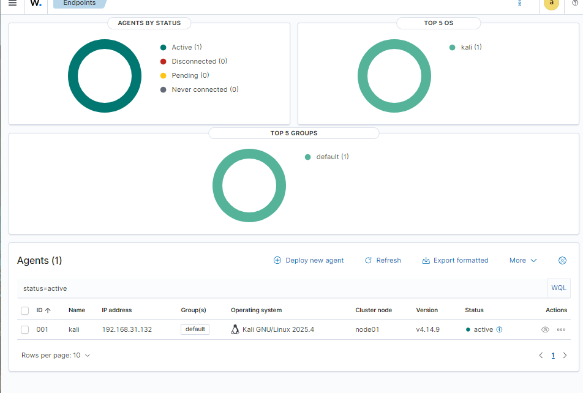
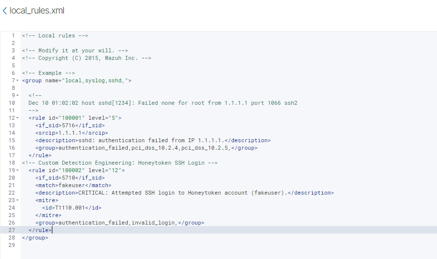
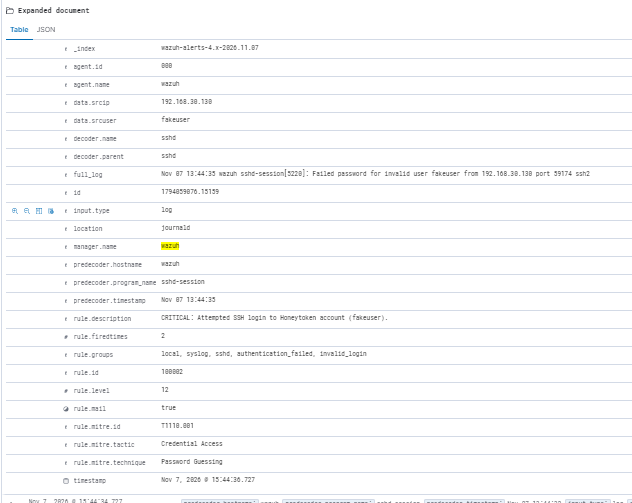

# Lab 1: Deployment and First Custom Detection Rule

## Objective
Deploy a working Wazuh SIEM, connect an endpoint, and write a custom rule that raises the severity of failed logins against a specific monitored username.

## Environment
- Wazuh 4.14.9 all-in-one on Ubuntu Server (VMware)
- Kali Linux VM with the Wazuh agent
- See the [README](README.md) for the network layout

## Steps

### 1. Deploy the Wazuh server
- Ran the official all-in-one install script on the Ubuntu VM.
- Logged in to the dashboard over HTTPS with the generated `admin` credentials.

### 2. Enroll the Kali endpoint
- Used the dashboard's **Deploy new agent** wizard (Linux, DEB amd64) with the manager's IP.
- Installed and started the agent on Kali, then confirmed it showed as **Active**.
- Reviewed the first events from the agent: a "new agent connected" event, followed by a Security Configuration Assessment (CIS benchmark) scan.



### 3. Generate a baseline alert
- Attempted SSH logins with a non-existent user (`fakeuser`) to the Ubuntu server.
- Confirmed in the system journal that SSH logged the failures, then found the matching Wazuh alerts:

| Rule ID | Level | Description |
|---|---|---|
| 5710 | 5 | sshd: Attempt to login using a non-existent user |
| 5503 | 5 | PAM: User login failed |
| 2502 | 10 | syslog: User missed the password more than one time |

### 4. Write a custom rule (ID 100002)
Edited `/var/ossec/etc/rules/local_rules.xml` to add a rule that:
- Builds on the default rule 5710 (`<if_sid>5710</if_sid>`)
- Matches the string `fakeuser` in the log (`<match>fakeuser</match>`)
- Raises the alert to **level 12** and tags it with MITRE ATT&CK **T1110.001** (Brute Force: Password Guessing)

```xml
<rule id="100002" level="12">
  <if_sid>5710</if_sid>
  <match>fakeuser</match>
  <description>CRITICAL: Attempted SSH login to Honeytoken account (fakeuser).</description>
  <mitre>
    <id>T1110.001</id>
  </mitre>
  <group>authentication_failed,invalid_login,</group>
</rule>
```



### 5. Apply and verify
- Restarted the manager: `sudo systemctl restart wazuh-manager`
- Repeated the failed login and confirmed a level 12 alert for rule 100002.



The alert records the decoder (`sshd`), the user tried (`data.srcuser: fakeuser`) and the source address (`data.srcip: 192.168.30.130`, Kali).

> My first run of this test showed the source as `192.168.30.1` (my laptop) because of a network configuration problem on Kali. I found and fixed it. See "Problem solved" in the [README](README.md).

## Troubleshooting
- **XML errors.** The manager refused to load the ruleset because of a syntax mistake and a duplicate rule ID. Custom rule IDs must be unique and in the 100000+ range, and every tag must be closed correctly. I fixed both and confirmed the manager loaded the rules.
- **Alerts not visible.** The dashboard was filtered to a single agent. I used the Discover view and searched `rule.id: 5710` instead.

## Limitations and improvements
- The rule matches a username I typed myself, so it demonstrates the mechanism rather than real-world detection. In production I would match a defined list of decoy or high-risk account names (for example `admin`, `backup`, service accounts) that should never receive logins. Calling the account a "honeytoken" is a simplification: the account doesn't actually exist on the system.
- A single failed login is not strong evidence of an attack. I would combine it with frequency and source information before treating it as critical.
- Level 12 is high severity on Wazuh's 0-15 scale, not the maximum.
