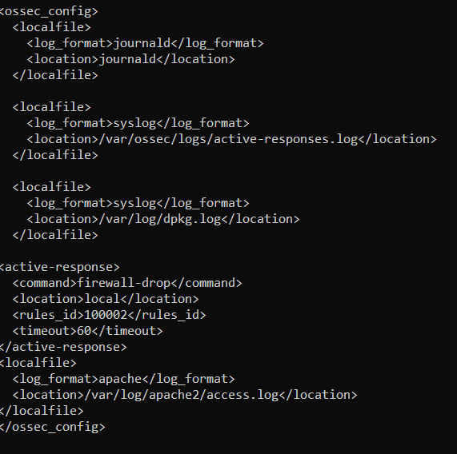
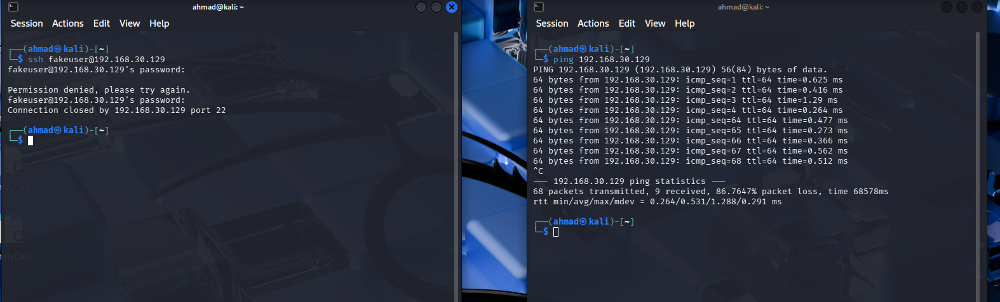
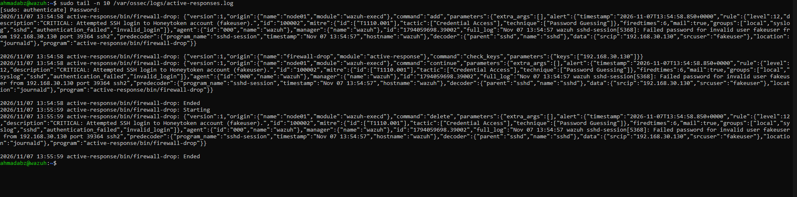
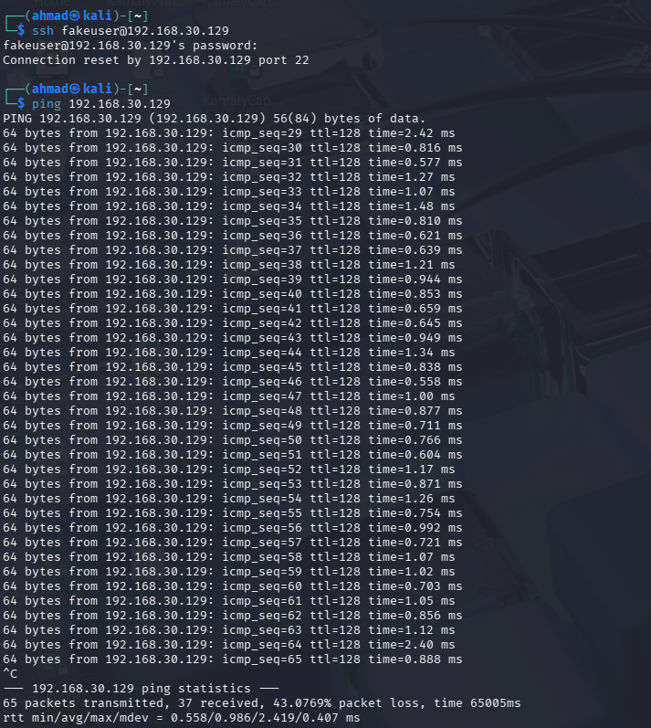

# Lab 2: Active Response (Automatic IP Blocking)

## Objective
Configure Wazuh to respond automatically to a specific alert by temporarily blocking the source IP address with the firewall.

## Environment
Same as Lab 1. Trigger: custom rule 100002 from Lab 1.

## Steps

### 1. Configure active response
- Edited the manager's `ossec.conf` (through the dashboard's configuration editor).
- Added an `<active-response>` block that runs the built-in **`firewall-drop`** script when rule **100002** fires, with a **60-second timeout**.

```xml
<active-response>
  <command>firewall-drop</command>
  <location>local</location>
  <rules_id>100002</rules_id>
  <timeout>60</timeout>
</active-response>
```



### 2. Validate and restart
- Checked the XML before applying, then restarted the manager: `sudo systemctl restart wazuh-manager`.

### 3. Test (after the network fix)
- Started a continuous `ping` to the server from Kali, then triggered the rule with failed SSH logins for `fakeuser`.
- After the failed password, the SSH connection was closed by the server, and the ping replies stopped. They resumed when the block expired (68 packets sent, 9 received). Reply TTL was 64, showing a direct path.



### 4. Verify what was blocked
The Wazuh active response log on the server shows the exact address and timing:

```
sudo tail -n 10 /var/ossec/logs/active-responses.log
```

| Time (UTC) | Event |
|---|---|
| 13:54:58 | Rule 100002 fires. `firewall-drop` runs `add` for **192.168.30.130** (Kali) |
| 13:55:59 | `firewall-drop` runs `delete`: the block is lifted 61 seconds later |



## Problem found and fixed: the first test blocked the wrong address
My first run of this lab looked successful, but the alerts showed the source as `192.168.30.1`, my host laptop, not Kali. Kali's host-only adapter had no IP address, so its traffic reached the server through the laptop, and the firewall rule blocked the laptop's address instead of Kali's. The ping reply TTL of 128 in the first run was a clue that the traffic was passing through the Windows host.



After I gave Kali's host-only adapter an address (`192.168.30.130`), the source in the alert, the TTL (64) and the blocked address in the active-response log all matched Kali. The full diagnosis is in the [README](README.md).

## Troubleshooting
- **XML structure error.** I added the block in the wrong place and ended up with an extra closing `</ossec_config>` tag. Wazuh's analysis engine won't start with invalid configuration, so I removed the stray tag and validated before restarting.

## Limitations and improvements
- Automated blocking can be abused: an attacker who spoofs a source address can get a legitimate host blocked. In production I would add an allow list (internal admin hosts, scanners) and use blocking only for high-confidence rules.
- A 60-second block is a demonstration value. Real timeouts and escalation (longer blocks for repeat offenders) would depend on policy.
- This is automated containment of one IP address, not a full intrusion prevention system.
