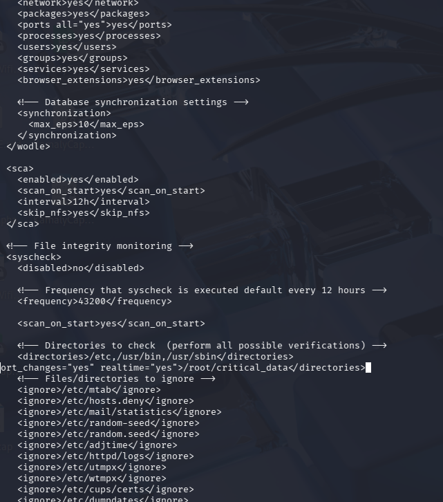
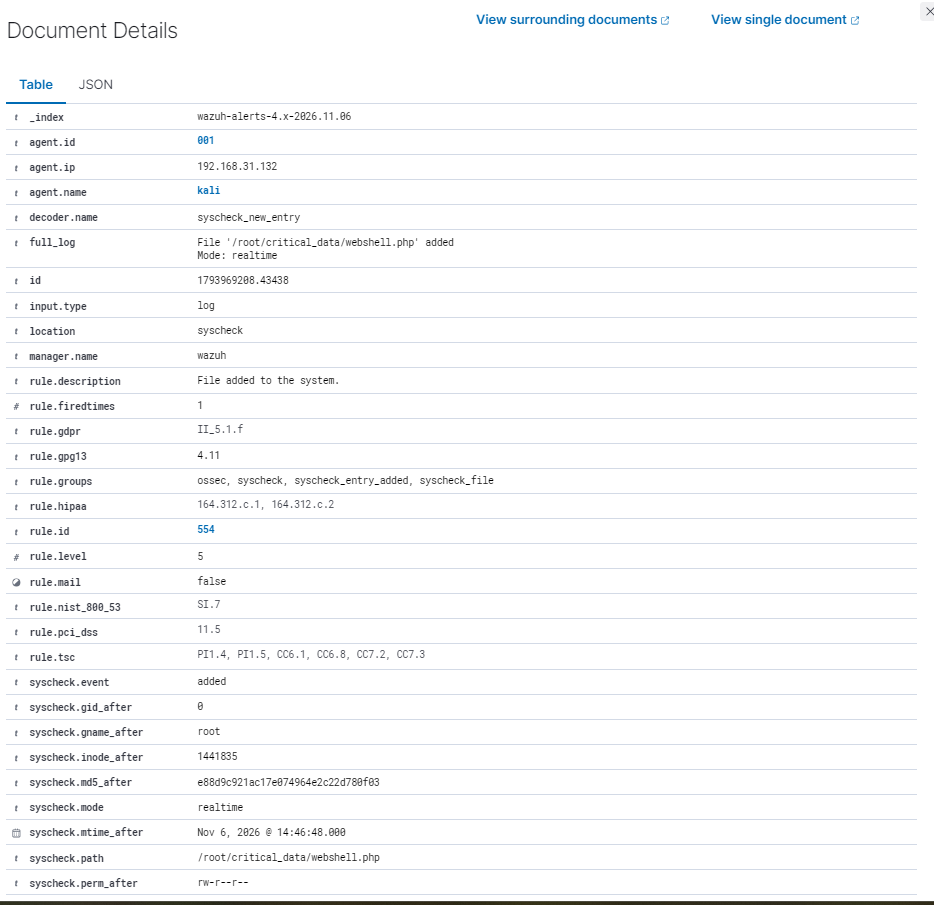
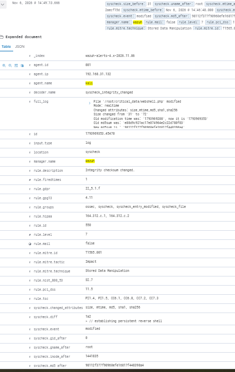

# Lab 3: File Integrity Monitoring (FIM)

## Objective
Detect unauthorized changes to a sensitive directory in real time, and see exactly what changed in a file.

## Environment
Wazuh agent on the Kali VM; manager on the Ubuntu server.

## Steps

### 1. Configure monitoring on the agent
- Edited `/var/ossec/etc/ossec.conf` on the endpoint and added the test directory `/root/critical_data` to the `syscheck` (FIM) section with real-time monitoring and change reporting:

```xml
<directories check_all="yes" report_changes="yes" realtime="yes">/root/critical_data</directories>
```

| Attribute | Purpose |
|---|---|
| `check_all="yes"` | Track all file attributes (hashes, permissions, owner, size) |
| `report_changes="yes"` | Store the text difference when a file changes |
| `realtime="yes"` | Alert immediately instead of waiting for the periodic scan (default is every 12 hours) |

- Restarted the agent: `sudo systemctl restart wazuh-agent`.



### 2. Simulate an attacker dropping a web shell
- Created a file named `webshell.php` in the monitored directory.
- Wazuh raised **rule 554** ("File added to the system", level 5) in real time. The alert includes the path, owner, permissions and MD5 hash of the file.



### 3. Simulate payload modification
- Appended a harmless placeholder comment that resembles reverse-shell code to the same file.
- Wazuh raised **rule 550** ("Integrity checksum changed", level 7), tagged with MITRE ATT&CK **T1565.001** (Stored Data Manipulation).
- The alert records which attributes changed (`size`, `mtime`, `md5`, `sha1`, `sha256`), the size change (31 to 72 bytes), the old and new hashes, and in `syscheck.diff` the exact line that was added: `// establishing persistent reverse shell`.



## Troubleshooting
- **Agent failed to start** after my edit. A malformed closing tag in `ossec.conf` was the cause. After correcting it, the agent started and began monitoring.

## Limitations and improvements
- I monitored a test directory on Kali, which is my attacker machine. It would be more realistic to monitor a web root or system directory such as `/etc` on the target server (Ubuntu), where real tampering would matter.
- Detecting a new or changed file is not the same as detecting persistence in general. Persistence also includes cron jobs, services, startup scripts and registry changes, which need their own monitoring.
- Real-time monitoring uses more resources, so on production systems I would limit it to high-value paths.
