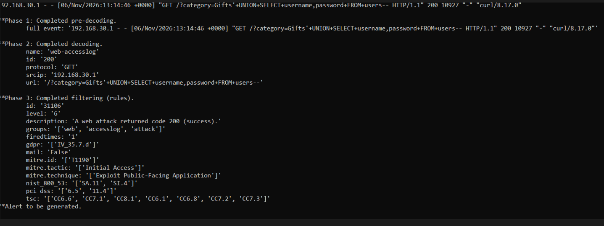
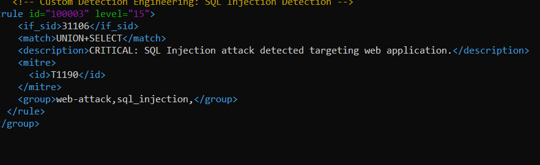

# Lab 4: Web Attack Detection in Apache Logs

## Objective
Send web server logs to Wazuh, detect SQL injection attempts, and write a custom rule that raises their severity.

## Environment
Apache web server on the Ubuntu server; attacks sent from Kali with `curl`.

## Steps

### 1. Ingest the Apache access log
- Installed Apache on the Ubuntu server.
- Added a `<localfile>` entry to the manager's `ossec.conf` so Wazuh reads `/var/log/apache2/access.log`:

```xml
<localfile>
  <log_format>apache</log_format>
  <location>/var/log/apache2/access.log</location>
</localfile>
```

### 2. Simulate a SQL injection attempt
- From Kali, sent this request with `curl`:

```
GET /?category=Gifts'+UNION+SELECT+username,password+FROM+users--
```

- Tested the resulting log line with `wazuh-logtest`. The decoder `web-accesslog` extracted the URL and source address, and Wazuh's default rule **31106** matched ("A web attack returned code 200 (success)", level 6), mapped to MITRE ATT&CK **T1190** (Exploit Public-Facing Application).



### 3. Write a custom rule (ID 100003)
Added a rule to `/var/ossec/etc/rules/local_rules.xml` that chains onto 31106 (`<if_sid>31106</if_sid>`) and matches the URL-encoded pattern `UNION+SELECT`, raising the alert to **level 15**:

```xml
<rule id="100003" level="15">
  <if_sid>31106</if_sid>
  <match>UNION+SELECT</match>
  <description>CRITICAL: SQL Injection attack detected targeting web application.</description>
  <mitre>
    <id>T1190</id>
  </mitre>
  <group>web-attack,sql_injection,</group>
</rule>
```



### 4. Test before applying
- Used the built-in tester: `sudo /var/ossec/bin/wazuh-logtest`, pasting a sample log line to check which decoder and rule matched.
- Restarted the manager, re-sent the attack and confirmed the level 15 alert.

## Limitations and improvements
- **This shows detection, not exploitation.** Apache's default page returns HTTP 200 to almost any request, so the rule description "(success)" only reflects the status code. There was no vulnerable application or database behind it (the response was 10,927 bytes, the size of the default page).
- **The pattern is narrow.** The rule only matches the plus-encoded form `UNION+SELECT`. Real payloads use `%20`, inline comments, mixed case and other tricks. A better rule would cover multiple encodings or use regular expressions.
- **Level 15 is too noisy for production.** Public-facing sites receive these probes constantly. I would reserve the highest severity for cases with more context, such as repeated attempts from one source, or a successful response combined with unusual database errors.
- A stronger setup would pair Wazuh with a web application firewall and look at response sizes and error patterns, not just the request.
