# Lab 5: Vulnerability Scanning and Remediation (Tenable Nessus)

## Objective
Scan my own SIEM server with Nessus, first without and then with credentials, and compare what each scan sees. Pick a finding, find its root cause, fix it, and confirm the fix with a rescan. Also check what the scan looked like from the SIEM's side.

## Environment
- **Scanner:** Tenable Nessus Essentials on the Kali VM (web interface on `https://localhost:8834`)
- **Target:** the Ubuntu Server running Wazuh (`192.168.30.129`)
- **Scan template:** Basic Network Scan, run first without credentials, then with an SSH login plus `sudo`
- See the [README](README.md) for the network layout

Nessus Essentials is the free version and is limited to 5 hosts, which is plenty for this lab. I reused one scan for every run and only changed its settings, so all the Nessus screenshots carry the original scan name, "Uncredentialed Baseline". The **History** tab counts the runs.

---

## Steps

### 1. Baseline scan without credentials
Without credentials, Nessus only sees what the network exposes: open ports, service banners and TLS settings. That is roughly what an outsider on the same network would see.

- **Auth: Fail.** This is expected. I gave Nessus no credentials, so it could not run local checks, and the report says so in two informational findings ("Target Credential Status ... No Credentials Provided" and "OS Security Patch Assessment Not Available").
- **Result:** 0 Critical, 0 High, 3 Medium, 59 informational findings, in 17 minutes.
- The TLS findings covered two encrypted services, and only the self-signed certificate issues were flagged there.

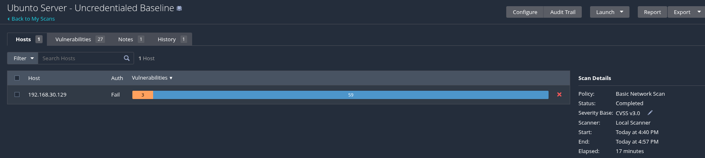

### 2. Credentialed scan
Next I added an SSH account with `sudo` on my own lab server, so Nessus could log in and check installed packages and local configuration. The credentials are stored only in the scan settings in my lab.

- **Auth: Pass.**
- **Result:** 0 Critical, **1 High**, 5 Medium, 108 informational findings, in 31 minutes.

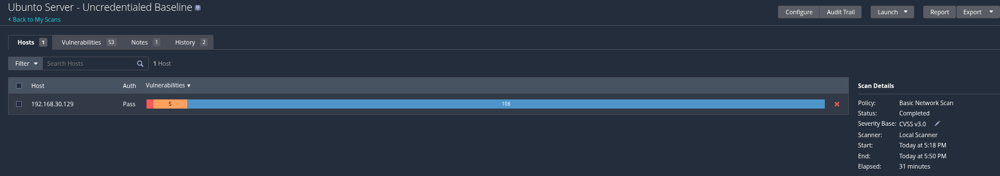

| | Without credentials | With credentials |
|---|---|---|
| Authentication | Fail (none given) | Pass |
| High | 0 | 1 |
| Medium | 3 | 5 |
| Informational | 59 | 108 |
| Vulnerability entries | 27 | 53 |
| TLS services tested | 2 | 3 |
| Scan time | 17 min | 31 min |

**The surprise.** The new High finding wasn't a package problem. It is SWEET32, a check Nessus runs over the network, so in theory the first scan could have found it too. It most likely didn't, because the first scan didn't test the port the problem was on.. The TLS findings counted two services without credentials and three with credentials, and the third one was the Wazuh API on port `55000`.

The most likely reason: without credentials, the Basic Network Scan only checks a list of common ports, and `55000` isn't on it. With SSH access, Nessus asks the server itself which ports are listening, so nothing is missed. So credentials didn't only add local checks, they also gave the network checks a complete list of ports.

### 3. Pick a finding and understand it
I chose the only High finding, which was also something I could trace to a configuration I control:

| Item | Value |
|---|---|
| Finding | SSL Medium Strength Cipher Suites Supported (SWEET32) |
| Nessus plugin | 42873 |
| CVE | CVE-2016-2183 |
| CVSS v3.0 | 7.5 (High), `AV:N/AC:L/PR:N/UI:N/S:U/C:H/I:N/A:N` |
| Nessus VPR | 5.0 (Nessus's risk factor: Medium) |
| EPSS | 0.947 (as shown by Nessus) |
| Port | `55000/tcp` |
| Weak cipher reported | `ECDHE-RSA-DES-CBC3-SHA` (3DES, a 64-bit block cipher, with SHA-1) |

**What it means.** SWEET32 is a birthday-style attack on 64-bit block ciphers such as 3DES. With enough encrypted traffic captured from one long-lived TLS session, an attacker could recover parts of the plaintext. CVSS rates it High because it needs no login and exposes data. Nessus's own priority rating is lower (VPR 5.0) because a proof of concept exists but there is no recorded attack activity, and the attack needs a very large amount of traffic. So it is hard to exploit in practice, but the weak cipher is easy to remove, and scanners and auditors flag it.

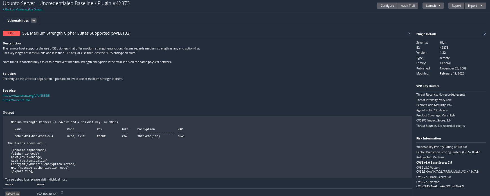

### 4. Find where the cipher list comes from
- Port `55000` belongs to the Wazuh API daemon (`wazuh-apid`). `netstat` isn't installed on this Ubuntu server, so I used `ss`:

```bash
sudo ss -tulnp | grep 55000
```

- The API's settings live in `/var/ossec/api/configuration/api.yaml`. Its `https:` block has an `ssl_ciphers` setting, and Wazuh's own example value there (`HIGH:!aNULL:!MD5:!3DES`) already excludes 3DES. So the question was why 3DES was still offered.

### 5. First fix attempt, and why it didn't work
I changed the `ssl_ciphers` value to two AES-GCM suites. Nothing changed:

- The next credentialed scan still reported SWEET32 on `55000`:

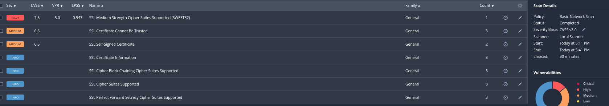

- Even after restarting the manager, a forced TLS 1.2 handshake from Kali still picked `ECDHE-RSA-AES256-SHA`, a CBC cipher with SHA-1, which my new list didn't allow:

```bash
echo | openssl s_client -connect 192.168.30.129:55000 -tls1_2 2>&1 | grep -E "Protocol|Cipher|alert|error"
```

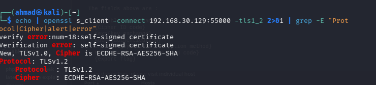

So I checked what the file actually contained, by printing it without comments and blank lines:

```bash
sudo grep -vE '^\s*#|^\s*$' /var/ossec/api/configuration/api.yaml
```

**It printed nothing.** Every line in the file is commented out. Its first line says `USE THIS FILE AS A TEMPLATE. UNCOMMENT LINES TO APPLY CUSTOM CONFIGURATION`. I had edited the value but left the `#` in front of it, like the rest of the `https:` block.

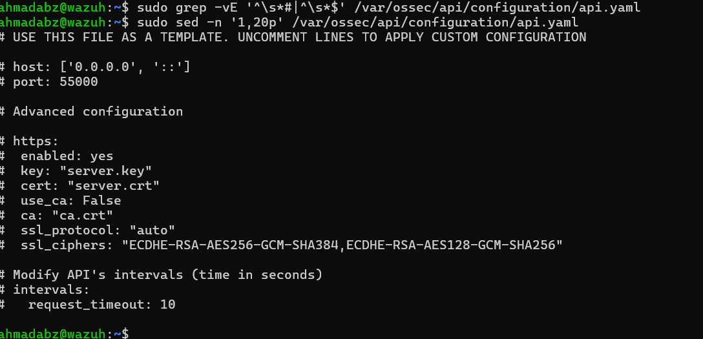

**Root cause.** No setting in `api.yaml` had ever been active, so no cipher list was set and the API used a default list that still accepted 3DES and other CBC/SHA-1 ciphers over TLS 1.2. Modern clients negotiate TLS 1.3 and never hit the problem, but a client that asks for TLS 1.2 could still be offered the weak ciphers.

**Lesson.** Check what configuration is actually loaded, not what the file appears to say.

### 6. Fix it
I uncommented the `https:` block (YAML needs exact 2-space indentation) and limited the TLS 1.2 ciphers to two AES-GCM suites. I kept `use_ca: False` so the Wazuh dashboard could keep talking to the API.

```yaml
https:
  enabled: yes
  key: "server.key"
  cert: "server.crt"
  use_ca: False
  ca: "ca.crt"
  ssl_protocol: "auto"
  ssl_ciphers: "ECDHE-RSA-AES256-GCM-SHA384,ECDHE-RSA-AES128-GCM-SHA256"
```

Then I restarted the manager and checked the API log for startup errors:

```bash
sudo systemctl restart wazuh-manager
sudo tail -n 10 /var/ossec/logs/api.log
```

The log showed the API starting cleanly and listening on port `55000`, so the YAML parsed.

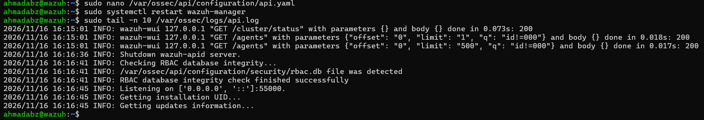

### 7. Verify the fix
**Quick check from Kali.** The same forced TLS 1.2 handshake now negotiates `ECDHE-RSA-AES256-GCM-SHA384` instead of `ECDHE-RSA-AES256-SHA`:

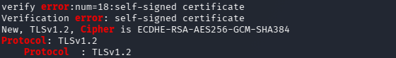

This shows what the server chooses now. It doesn't prove every weak cipher is refused, and I couldn't test 3DES directly: Kali's OpenSSL won't offer 3DES at all, even with `@SECLEVEL=0`. So the full rescan is the real proof.

**Rescan.** The credentialed rescan (25 minutes) passed authentication and showed **0 Critical and 0 High**: 5 Medium and 111 informational findings. Plugin 42873 is gone.

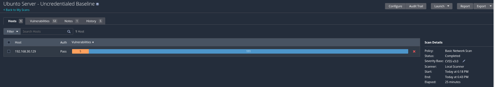

The TLS group confirms it: SWEET32 is no longer listed, and "SSL Cipher Block Chaining Cipher Suites Supported" dropped from three services to two, so port `55000` no longer offers any CBC cipher.

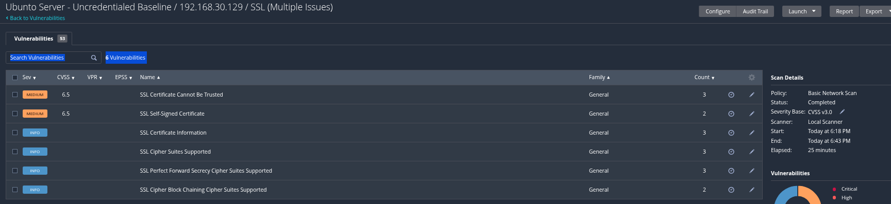

### 8. Look at the scan from the SIEM's side
During the credentialed scan after my first attempt, Wazuh raised two **level 15** alerts, "Shellshock attack detected" (rules `31168` and `31169`, CVE-2014-6271 and CVE-2014-6278, MITRE ATT&CK T1190 and T1068). These are Wazuh's built-in Shellshock rules. They fired on the Apache access log on the same server, where Nessus sent its web-vulnerability probes.

These are not real attacks. It is my own authorized scan, so in a company I would expect the scanner's address to be on a known list so analysts don't waste time on it. It also shows that the Apache log collection from Lab 4 catches real scanner traffic, not only the test requests I sent by hand.

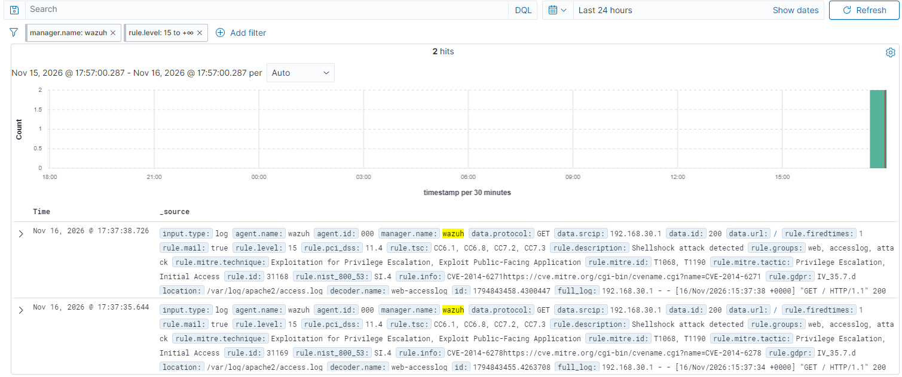

**One thing to note.** The alerts list the source as `192.168.30.1`, my host laptop, instead of Kali (`192.168.30.130`). That is the same symptom as the routing problem described in the README, so Kali's host-only adapter had most likely lost its address again before this scan. It doesn't change the detection, but an automated block on that address would have hit my laptop. It's a reminder to check `ip -br a` on Kali before running attack tests.

---

## Findings that remain, and what I decided
Five Medium findings remain. The two on the TLS services are:

| Finding | Severity | CVSS v3.0 | Decision | Reason |
|---|---|---|---|---|
| SSL Certificate Cannot Be Trusted | Medium | 6.5 | Accepted | Wazuh generates self-signed certificates for its own components |
| SSL Self-Signed Certificate | Medium | 6.5 | Accepted | Same cause: no public or internal certificate authority in my lab |

Accepting these is reasonable here because the server only sits on a host-only lab network. It would not be fine in production, where I would use certificates from an internal certificate authority. I have not yet triaged the other three Medium findings or the informational ones.

## Troubleshooting
- **Editing a commented-out line.** `api.yaml` is a template where every line is commented out. My first edit changed a value but left its `#`, so it had no effect. Printing the file without comments (`grep -vE '^\s*#|^\s*$'`) showed the problem immediately.
- **`netstat` not found.** Ubuntu Server doesn't install `net-tools` by default. `ss -tulnp` gives the same information.
- **`nmap --script ssl-enum-ciphers` printed nothing.** Nmap reported the service on `55000` as `unknown`, so the TLS script didn't run. I tested the port directly with `openssl s_client` instead.
- **"no cipher match" from OpenSSL.** When I tried to force 3DES, the error came from Kali's own OpenSSL, which refuses to offer 3DES. It is a client-side error, not the server's answer, so it proves nothing about the server.
- **Indentation in `api.yaml`.** YAML is strict about spaces. I checked the API log after each restart to be sure the file parsed.
- **Scan time.** The credentialed scans took 25 to 31 minutes, against 17 without credentials.

## Limitations and improvements
- One server, one fixed finding. A real vulnerability program covers many assets, ranks them by risk and tracks fixes over time.
- Restricting `ssl_ciphers` to two ECDHE-RSA suites can lock out very old clients. I tested only with the Wazuh dashboard, which still connected.
- I used my own admin account for the credentialed scan. In production I would create a dedicated, limited scan account.
- The uncredentialed scan only covered common ports. Rerunning it with all ports (1-65535) would show exactly what an outsider can reach.
- Next steps: triage the remaining Medium findings, make Kali's host-only connection come up automatically so the source address stays correct, and compare Nessus's results with Wazuh's own vulnerability detection module.
