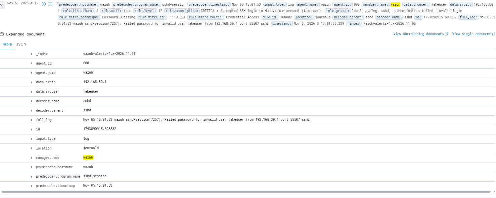
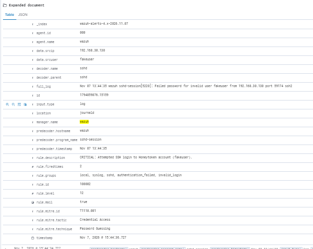

# Wazuh SIEM Home Lab

A hands-on home lab where I deployed the Wazuh SIEM, connected an endpoint, and practiced the core SOC workflow: collecting logs, triaging alerts, writing custom detection rules, and automating a response.

**Author:** Ahmad Abou-Zeid, Computer Science graduate (Lebanese University), focused on SOC / security analyst roles.

---

## Lab environment

| Component | Details |
|---|---|
| Hypervisor | VMware Workstation (host: 16 GB RAM laptop) |
| SIEM server | Ubuntu Server 26.04 LTS, 8 GB RAM, Wazuh 4.14.9 (all-in-one: manager, indexer, dashboard) |
| Endpoint / attacker | Kali Linux VM with the Wazuh agent installed |

| Network | Addresses |
|---|---|
| VMware host-only (lab traffic) | `192.168.30.0/24`: server `192.168.30.129`, Kali `192.168.30.130`, host laptop `192.168.30.1` |
| VMware NAT (internet for updates) | `192.168.31.0/24`: server `192.168.31.131`, Kali `192.168.31.132` |

```
  Kali Linux VM (attacker + Wazuh agent)          Ubuntu Server
  eth0  192.168.30.130  (host-only)  ───────────► 192.168.30.129  (host-only)
  eth1  192.168.31.132  (NAT, updates only)       Wazuh manager + indexer
                                                  + dashboard + Apache
```

Attack simulations were run only against my own lab machines.

---

## Labs

| # | Lab | Skills practiced |
|---|---|---|
| 1 | [Deployment and first custom detection rule](01-deployment-and-first-custom-rule.md) | SIEM deployment, agent enrollment, alert triage, custom rule (XML) |
| 2 | [Active response: automatic IP blocking](02-active-response.md) | Wazuh active response, firewall-drop, timeouts, testing |
| 3 | [File integrity monitoring](03-file-integrity-monitoring.md) | FIM (syscheck), real-time monitoring, file change alerts |
| 4 | [Web attack detection in Apache logs](04-web-attack-detection.md) | Log ingestion, rule chaining, `wazuh-logtest`, MITRE ATT&CK mapping |

---

## Problem solved: the SIEM saw the wrong attacker address

**Symptom.** My first alerts showed the attacker's address as `192.168.30.1`, which is my host laptop, not Kali. Ping replies from the server also had TTL 128 (a Windows default) instead of Linux's 64.



**Diagnosis.** On Kali, `ip -br a` showed that `eth0` (the host-only adapter) was up but had **no IPv4 address**, and `ip route get 192.168.30.129` showed traffic leaving through the NAT gateway (`via 192.168.31.2 dev eth1`). So Kali's traffic to the server was being forwarded by my laptop, and the server logged the laptop's address.

**Cause.** Kali had two adapters, but NetworkManager only had one connection profile, bound to the NAT interface. The host-only interface was never configured.

**Fix.** Activated `eth0` with `nmcli device connect eth0`, which gave it `192.168.30.130`. `ip route get` then showed a direct path (`dev eth0 src 192.168.30.130`).

**Result.** Alerts now show Kali's own address, and the active-response block in Lab 2 targets Kali instead of my laptop.



**Lesson.** Check what a SIEM actually sees. An alert is only as trustworthy as the network path behind it, and an automated block on a wrong address can cut off the wrong machine.

---

## What this lab shows (and what it doesn't)

**It shows** that I can install and configure a SIEM, onboard an endpoint, read and triage alerts, write and test custom detection rules, and troubleshoot configuration and network problems.

**It does not show** production-scale experience. This is a single-server lab with simulated attacks on my own machines. The custom rules demonstrate the mechanism, and each lab includes a "Limitations" section explaining how I would tune or harden them in a real environment.

---

## Setup notes and lessons learned

- **Unsupported OS warning.** The Wazuh installer warned that Ubuntu 26.04 isn't on its recommended list. The install completed and the components ran, but a supported version (22.04 / 24.04) would be the safer choice.
- **Slow download.** The indexer package (~875 MB) took hours at ~100 KB/s. I confirmed it was progressing by watching `/var/cache/apt/archives/partial/` instead of restarting.
- **Disk space.** Ubuntu's installer allocated only half of the 50 GB disk. I extended the logical volume with `pvresize` and `lvextend -r`.
- **Working remotely.** The VM console didn't support paste, so I connected over SSH from PowerShell.
- **Time zones.** The server logs in UTC, while the dashboard shows local time (UTC+2).
- **Dashboard filters.** An agent filter pinned to one agent hid alerts from another. The Discover view with the `wazuh-alerts-*` index pattern avoided it.

---

## Skills demonstrated

SIEM deployment (Wazuh) · Endpoint log forwarding · Alert triage · Custom detection rules (XML) · Active response · File integrity monitoring · Web log analysis · Linux administration · Network troubleshooting (routing, NetworkManager) · MITRE ATT&CK mapping
